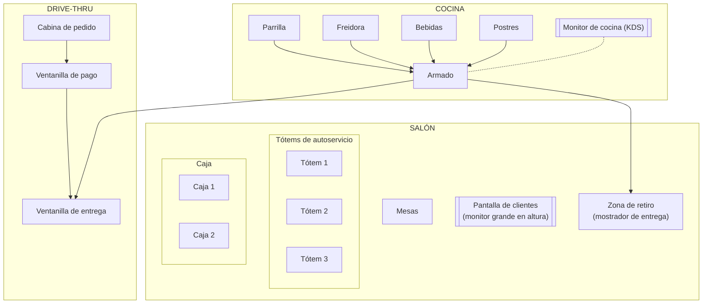
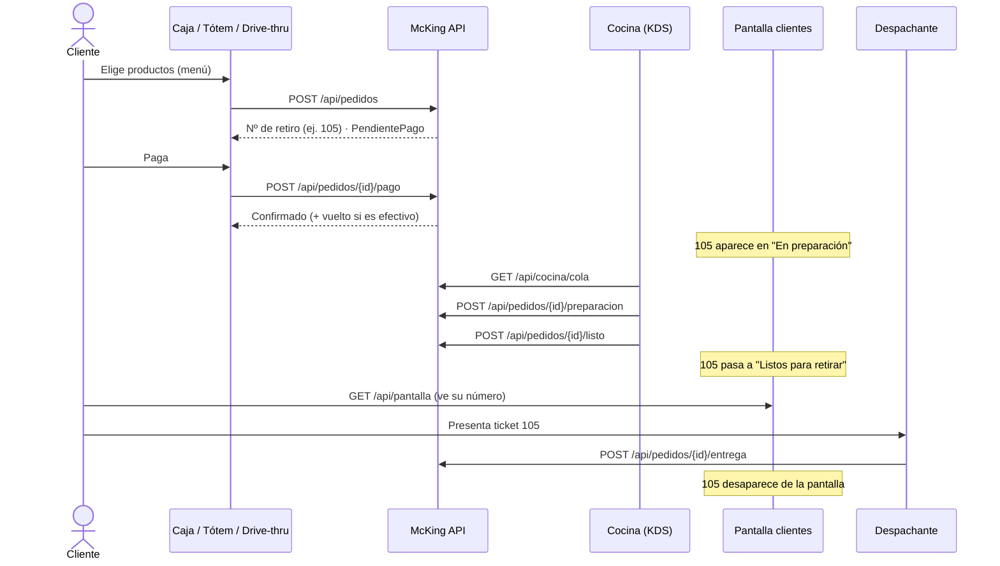
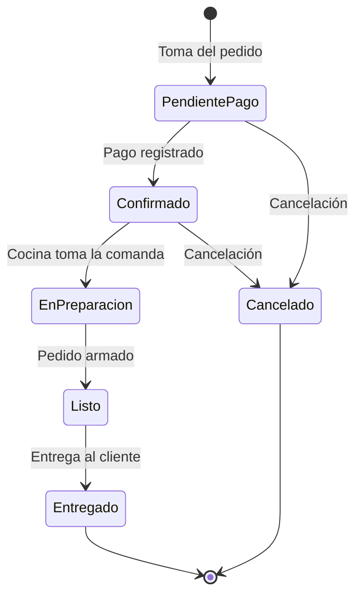
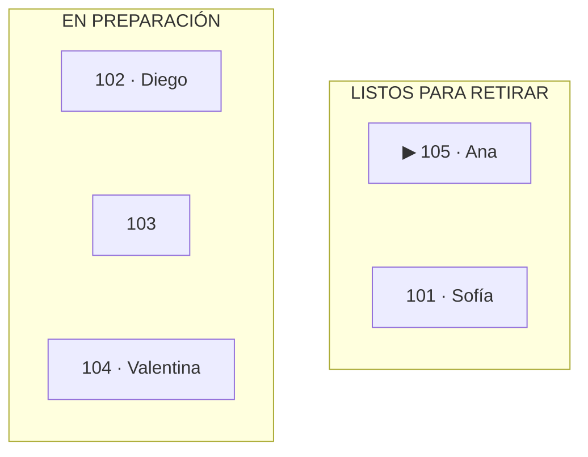
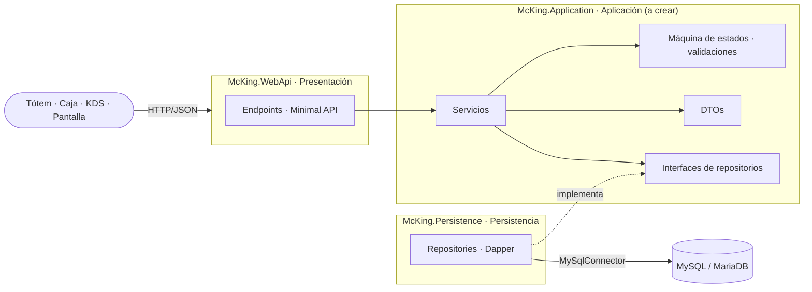
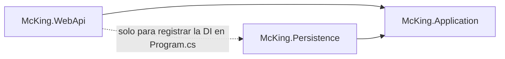
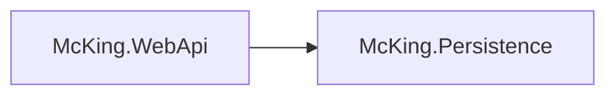
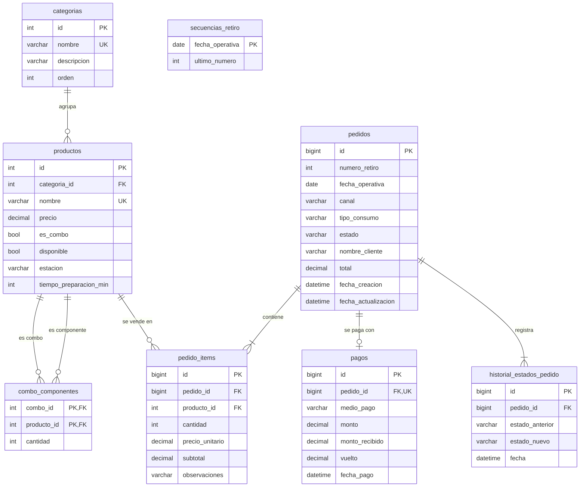
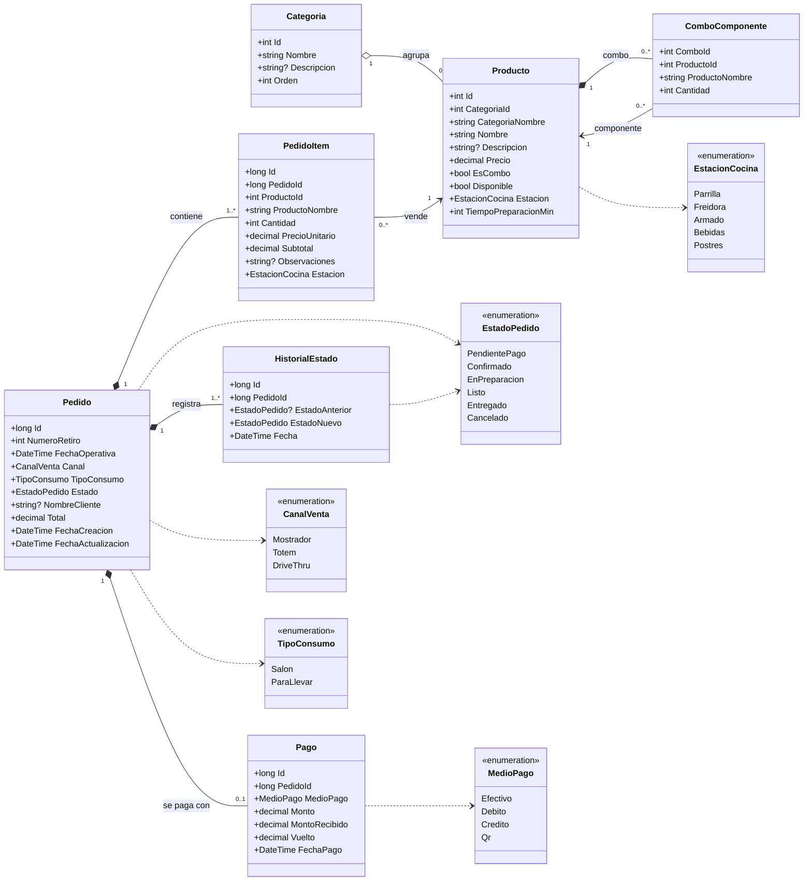
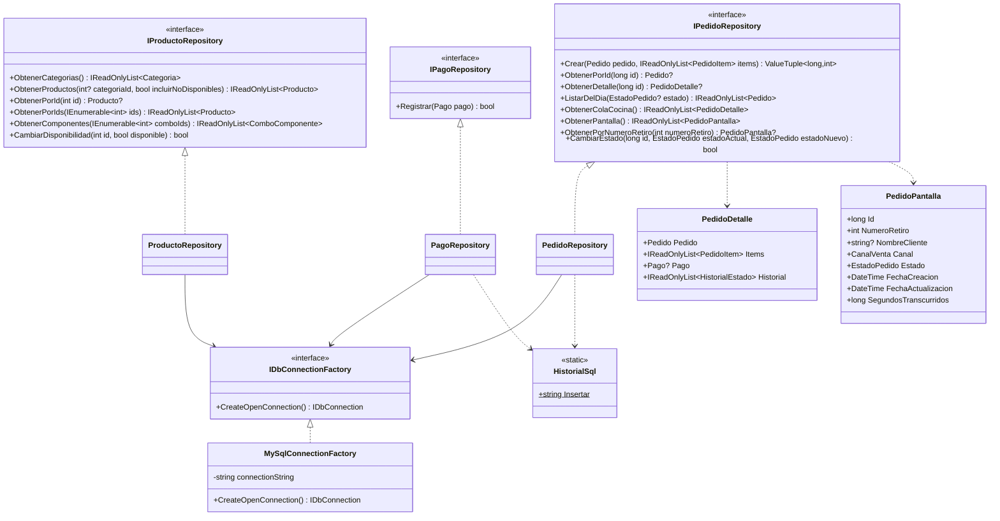

# McKing — Simulación de una casa de comidas rápidas


Web API en **.NET 10** que simula el circuito completo de compra en un local de comidas rápidas: desde que el cliente hace su pedido hasta que lo recibe. Incluye los endpoints que alimentan la **pantalla del cliente**, donde cada uno sigue el estado de su pedido por número de retiro.

Arquitectura en **3 capas**:

- **Presentación:** ASP.NET Core Web API con **Minimal API** + OpenAPI / Swagger UI.
- **Aplicación:** servicios con la lógica de negocio. *A crear.*
- **Persistencia:** repositorios con **Dapper** sobre **MySQL** (compatible con MariaDB).

> **Estado del proyecto:** el repositorio es una base para completar.
> - **Persistencia:** repositorios, entidades, scripts de base de datos y backup, todo completo.
> - **Presentación:** esqueleto con `Program.cs`, Swagger y configuración. **Sin endpoints.**
> - **Aplicación:** no existe. Hay que crearla con los servicios que implementan las reglas de negocio de este relevamiento.
>
> Los pasos están en [7.4 Trabajo a realizar](#74-trabajo-a-realizar) y la especificación de endpoints en [9. Endpoints](#9-endpoints).

---

## Índice

1. [Objetivo del sistema](#1-objetivo-del-sistema)
2. [Relevamiento del local](#2-relevamiento-del-local)
3. [Circuito del pedido paso a paso](#3-circuito-del-pedido-paso-a-paso)
4. [Estados del pedido y reglas de negocio](#4-estados-del-pedido-y-reglas-de-negocio)
5. [Pantalla del cliente](#5-pantalla-del-cliente)
6. [Situaciones de excepción](#6-situaciones-de-excepción)
7. [Arquitectura](#7-arquitectura)
8. [Modelo de datos](#8-modelo-de-datos)
9. [Endpoints](#9-endpoints)
10. [Cómo ejecutar el proyecto](#10-cómo-ejecutar-el-proyecto)
11. [Ejemplo de flujo completo](#11-ejemplo-de-flujo-completo)

---

## 1. Objetivo del sistema

El relevamiento se hizo sobre un local de comidas rápidas típico (hamburguesas, papas, bebidas y postres) que vende por tres canales y tiene cocina a la vista. Los problemas detectados en el local fueron:

- Los clientes **no saben en qué estado está su pedido** y se acercan al mostrador a preguntar, lo que congestiona la zona de entrega.
- La cocina recibe los pedidos en papel y **no respeta siempre el orden de llegada**.
- No queda registro de **cuánto tarda** cada pedido en cada etapa, por lo que el encargado no puede medir tiempos de servicio.
- Se toman pedidos de productos **que ya no hay**, y el error se descubre recién en la cocina.

El sistema busca:

1. Registrar cada pedido con un **número de retiro** visible para el cliente.
2. Ordenar el trabajo de la cocina en una **cola FIFO** según el momento de pago.
3. Mostrar en una **pantalla** qué pedidos se están preparando y cuáles están listos.
4. Dejar **historial con fecha y hora** de cada cambio de estado.
5. Impedir la venta de productos **sin stock** y los cambios de estado incoherentes.

---

## 2. Relevamiento del local

### 2.1 Descripción general

McKing es un local de comidas rápidas de servicio en mostrador (no hay mozos). El cliente pide, paga, espera mirando la pantalla y retira su pedido cuando aparece su número en la columna **"Listos para retirar"**. Puede comer en el salón o llevarse el pedido.

- **Horario de atención:** todos los días, de 11:00 a 00:00.
- **Día operativo:** cada día calendario es un día operativo. La numeración de pedidos se reinicia todos los días y la pantalla solo muestra pedidos del día en curso.
- **Volumen estimado:** 300–500 pedidos diarios; picos de 12:00 a 14:30 y de 20:00 a 22:30.

### 2.2 Actores

| Actor | Descripción | Qué hace en el sistema |
|---|---|---|
| **Cliente** | Persona que compra. Puede identificarse con su nombre (opcional) para que aparezca en la pantalla. | Arma su pedido en el tótem o se lo dicta al cajero / operador del drive-thru. Consulta el estado en la pantalla. Retira el pedido. |
| **Cajero** | Atiende el mostrador de caja. | Toma pedidos en el canal Mostrador, cobra (efectivo, tarjeta o QR), entrega el vuelto y el ticket con el número de retiro. También cobra en efectivo los pedidos hechos en el tótem. |
| **Operador de drive-thru** | Atiende la cabina del drive-thru con auricular. | Toma pedidos en el canal DriveThru y los cobra en la primera ventanilla. |
| **Cocinero** | Trabaja en una estación de cocina (parrilla, freidora, bebidas, postres). | Mira el monitor de cocina, toma la comanda (la pasa a **En preparación**) y prepara su parte. |
| **Armador** | Arma la bandeja o bolsa con todos los productos del pedido. | Cuando el pedido está completo lo marca como **Listo**, lo que hace aparecer el número en la columna de listos. |
| **Despachante** | Atiende la zona de entrega (mostrador de retiro y ventanilla del drive-thru). | Llama el número, verifica el ticket y entrega el pedido (lo pasa a **Entregado**). |
| **Encargado de turno** | Supervisa el local. | Marca productos sin stock, autoriza cancelaciones y consulta tiempos e historial de pedidos. |

### 2.3 Sectores físicos



- **Salón:** mesas para consumir en el local y la **pantalla de clientes** visible desde todo el salón y desde la zona de retiro.
- **Tótems de autoservicio:** pantallas táctiles donde el cliente arma su pedido y paga con tarjeta o QR. Si elige pagar en efectivo, el pedido queda pendiente y se paga en caja.
- **Caja:** dos puestos de cobro con posnet y lector de QR.
- **Cocina:** dividida en **estaciones**. Cada producto tiene asignada la estación que lo prepara:
  - **Parrilla:** hamburguesas de carne y veggie.
  - **Freidora:** papas, aros de cebolla, nuggets y pollo crispy.
  - **Bebidas:** gaseosas, agua y café.
  - **Postres:** helados, sundaes y brownies.
  - **Armado:** junta los productos del pedido. Los combos se asignan a esta estación porque se arman con productos de las demás.
- **Monitor de cocina (KDS):** muestra las comandas en orden de llegada con sus observaciones ("sin pepinos", "sin hielo").
- **Zona de retiro:** mostrador donde el despachante entrega bandejas (salón) y bolsas (para llevar).
- **Drive-thru:** tres puntos: cabina de pedido, ventanilla de pago y ventanilla de entrega.

### 2.4 Menú

El menú se organiza en **categorías**, y cada **producto** tiene precio, estación de cocina y tiempo estimado de preparación.

| Categoría | Ejemplos |
|---|---|
| Hamburguesas | Clásica, con Queso, Doble King Bacon, Pollo Crispy, Veggie |
| Combos | Combo Clásico, Combo Doble King Bacon, Combo Crispy, Combo Infantil |
| Acompañamientos | Papas medianas / grandes, Aros de cebolla, Nuggets x6 |
| Bebidas | Gaseosa mediana / grande, Agua mineral, Café |
| Postres | Helado cono, Sundae dulce de leche, Brownie |

- **Combos:** un combo es un producto con precio promocional formado por otros productos (por ejemplo, sándwich + papas + bebida). El sistema guarda su composición (`combo_componentes`) para mostrarla en el menú.
- **Personalizaciones:** el cliente puede pedir cambios por ítem ("sin cebolla", "sin hielo"). Se cargan como **observaciones** del ítem y la cocina las ve en la comanda.
- **Disponibilidad:** el encargado puede marcar un producto **sin stock**. A partir de ese momento deja de mostrarse en el menú y no se puede vender.

### 2.5 Canales de venta

| Canal | Quién toma el pedido | Tipo de consumo | Cómo se paga |
|---|---|---|---|
| **Mostrador** | Cajero | Salón o para llevar | En caja, en el momento: efectivo, débito, crédito o QR |
| **Tótem** | El propio cliente | Salón o para llevar | En el tótem con tarjeta o QR; en efectivo, después en caja |
| **Drive-thru** | Operador de drive-thru | **Siempre para llevar** | En la ventanilla de pago |

### 2.6 Medios de pago

- **Efectivo:** el cajero informa el monto que entrega el cliente. Tiene que ser mayor o igual al total, y el sistema calcula el **vuelto**.
- **Débito / Crédito / QR:** se cobra el importe exacto. El sistema registra el pago como aprobado; la integración con el procesador de pagos queda fuera del alcance de la simulación.

---

## 3. Circuito del pedido paso a paso



### Paso 1 — Toma del pedido

1. El cliente consulta el menú (tablero, tótem o cajero), que muestra **solo los productos disponibles**.
2. Se cargan los ítems con su cantidad (1 a 20 por ítem) y sus observaciones.
3. Se indica el **canal** y el **tipo de consumo** (salón / para llevar). Opcionalmente se carga el **nombre del cliente**.
4. El sistema valida que los productos existan y estén disponibles, **congela el precio vigente** de cada uno, calcula el total y registra el pedido en estado **Pendiente de pago**.
5. Se asigna el **número de retiro** del día (101, 102, 103…), que figura en el ticket.

### Paso 2 — Pago

1. El cajero (o el tótem) registra el pago con su medio de pago.
2. En efectivo se informa el monto recibido y el sistema calcula el vuelto.
3. Con el pago aprobado, el pedido pasa a **Confirmado**: se envía a la cocina y el número aparece en la pantalla en la columna **"En preparación"**.

> El pago es lo que dispara la producción: **la cocina no prepara pedidos que no estén pagos.**

### Paso 3 — Cola de cocina

1. El monitor de cocina muestra los pedidos **Confirmados** y **En preparación**, ordenados por la **hora de pago** (FIFO).
2. Cada comanda indica número de retiro, canal, tipo de consumo (bandeja o bolsa) y los ítems con su estación y observaciones.

### Paso 4 — Preparación

1. Cuando la cocina empieza la comanda, la pasa a **En preparación**.
2. Cada estación prepara su parte. Por ejemplo, para el Combo Clásico la parrilla hace la hamburguesa, la freidora las papas y bebidas la gaseosa.
3. A partir de este momento el pedido **ya no se puede cancelar**.

### Paso 5 — Armado y aviso

1. El armador junta todos los productos en una bandeja (salón) o bolsa (para llevar).
2. Marca el pedido como **Listo**. El número pasa a la columna **"Listos para retirar"** de la pantalla, y los últimos en quedar listos aparecen primero.
3. En el drive-thru, el pedido se entrega en la ventanilla de entrega.

### Paso 6 — Entrega

1. El cliente ve su número en la pantalla y se acerca a la zona de retiro con el ticket.
2. El despachante verifica el número y entrega el pedido. Lo marca como **Entregado**.
3. El número desaparece de la pantalla. El pedido queda cerrado y su historial completo queda guardado.

### Resumen por canal

| Etapa | Mostrador | Tótem | Drive-thru |
|---|---|---|---|
| Toma | Cajero | Cliente | Operador (cabina) |
| Pago | Caja, en el momento | Tótem (tarjeta/QR) o caja (efectivo) | Ventanilla de pago |
| Seguimiento | Pantalla del salón | Pantalla del salón | Ventanilla / pantalla exterior |
| Entrega | Zona de retiro | Zona de retiro | Ventanilla de entrega |

---

## 4. Estados del pedido y reglas de negocio

### 4.1 Estados

| Estado | Significado | ¿Se muestra en pantalla? |
|---|---|---|
| `PendientePago` | Pedido registrado, falta pagar. | No |
| `Confirmado` | Pagado, en la cola de cocina. | Sí, en "En preparación" |
| `EnPreparacion` | La cocina lo está preparando. | Sí, en "En preparación" |
| `Listo` | Armado, esperando que el cliente lo retire. | Sí, en "Listos para retirar" |
| `Entregado` | El cliente lo retiró. Estado final. | No |
| `Cancelado` | Anulado antes de prepararse. Estado final. | No |

### 4.2 Transiciones permitidas



Cualquier otra transición (por ejemplo, pasar de `PendientePago` a `Listo` o cancelar un pedido `EnPreparacion`) se rechaza con **409 Conflict**, y la respuesta indica los estados permitidos.

### 4.3 Reglas de negocio

| Código | Regla |
|---|---|
| **RN-01** | Un pedido tiene al menos un ítem, y cada ítem tiene una cantidad entre 1 y 20. |
| **RN-02** | Solo se venden productos existentes y **disponibles** (con stock). |
| **RN-03** | El precio de cada ítem se **congela** al tomar el pedido (`precio_unitario`). Un cambio posterior de precio no afecta pedidos ya tomados. |
| **RN-04** | El total del pedido es la suma de los subtotales (`cantidad × precio_unitario`). |
| **RN-05** | Cada pedido recibe un **número de retiro** único dentro del día operativo. La numeración empieza en 101 y se reinicia cada día. |
| **RN-06** | Los pedidos del **drive-thru son siempre para llevar**. |
| **RN-07** | Un pedido se paga **una sola vez** y solo si está `PendientePago`. |
| **RN-08** | En **efectivo**, el monto recibido debe ser mayor o igual al total. El vuelto es `monto_recibido − total`. Con tarjeta o QR se cobra el importe exacto. |
| **RN-09** | La cocina solo prepara pedidos **pagados** (`Confirmado`), en orden **FIFO** según la hora de pago. |
| **RN-10** | Un pedido solo se puede **cancelar antes de que empiece su preparación** (`PendientePago` o `Confirmado`). |
| **RN-11** | `Entregado` y `Cancelado` son estados finales: el pedido ya no cambia. |
| **RN-12** | Cada cambio de estado queda registrado en el **historial** con estado anterior, estado nuevo, fecha y hora. |
| **RN-13** | Los cambios de estado usan **concurrencia optimista**: si dos puestos intentan mover el mismo pedido a la vez, solo uno lo logra y el otro recibe 409. |
| **RN-14** | La pantalla del cliente muestra **solo pedidos del día en curso**. |

### 4.4 Indicadores que permite el historial

Como cada transición queda con fecha y hora, se pueden calcular:

- **Tiempo de cobro:** de `PendientePago` a `Confirmado`.
- **Tiempo de espera en cola:** de `Confirmado` a `EnPreparacion`.
- **Tiempo de preparación:** de `EnPreparacion` a `Listo`.
- **Tiempo de retiro:** de `Listo` a `Entregado`.
- **Tiempo total de servicio:** de la toma a la entrega.

---

## 5. Pantalla del cliente

La pantalla es un monitor grande en el salón (y otro en el drive-thru) con **dos columnas**:



- **En preparación:** pedidos `Confirmado` y `EnPreparacion`, ordenados por número.
- **Listos para retirar:** pedidos `Listo`, con el último en quedar listo arriba.
- Si el cliente cargó su nombre, aparece junto al número.
- Al entregarse o cancelarse, el pedido sale de la pantalla.

Este proyecto **no incluye el frontend del monitor**. La API expone lo que necesita y el monitor (o cualquier cliente) lo consulta periódicamente (polling, por ejemplo cada 5 segundos):

| Endpoint | Uso |
|---|---|
| `GET /api/pantalla` | Contenido completo del monitor (las dos columnas). |
| `GET /api/pantalla/pedidos/{numeroRetiro}` | Estado puntual de un número del día, con un mensaje para el cliente y los minutos transcurridos. Pensado, por ejemplo, para un QR impreso en el ticket. |

Mensajes que recibe el cliente según el estado:

| Estado | Mensaje |
|---|---|
| `PendientePago` | "Tu pedido está pendiente de pago." (Tótem: "…Si elegiste efectivo, acercate a la caja.") |
| `Confirmado` | "¡Recibimos tu pedido! En breve comienza a prepararse." |
| `EnPreparacion` | "Estamos preparando tu pedido." |
| `Listo` | "¡Tu pedido está listo! Retiralo en el mostrador de entrega." (Drive-thru: "…Avanzá a la ventanilla de entrega.") |
| `Entregado` | "Pedido entregado. ¡Que lo disfrutes!" |
| `Cancelado` | "Tu pedido fue cancelado." |

---

## 6. Situaciones de excepción

| Situación | Cómo se resuelve |
|---|---|
| **Producto sin stock** | El encargado lo marca como no disponible (`PUT /api/menu/productos/{id}/disponibilidad`). Desaparece del menú, y si igual se intenta vender, la API responde **400**. |
| **Pago insuficiente en efectivo** | Si el monto recibido es menor al total, se rechaza con **400** y el pedido sigue `PendientePago`. |
| **Pago rechazado (tarjeta/QR)** | No se registra el pago. El pedido sigue `PendientePago` y el cliente puede pagar con otro medio o cancelar. |
| **Cliente se arrepiente antes de pagar** | Se cancela el pedido (`PendientePago → Cancelado`). |
| **Cliente se arrepiente después de pagar** | Se puede cancelar mientras siga `Confirmado`. La devolución del dinero es un procedimiento manual del encargado, fuera del alcance del sistema. |
| **Cancelación con el pedido en preparación** | No se permite (**409**): la comida ya se está haciendo. |
| **Dos puestos tocan el mismo pedido a la vez** | Concurrencia optimista: el segundo recibe **409** y vuelve a consultar el pedido. |
| **Pedido listo que nadie retira** | Sigue en la columna "Listos" hasta que se entrega. El despachante lo vuelve a llamar. El pedido no pasa al día siguiente porque la pantalla filtra por día operativo. |
| **Salto de estados** (ej. entregar algo que no está listo) | Se rechaza con **409**, indicando los estados permitidos. |

---

## 7. Arquitectura

### 7.1 Capas (arquitectura objetivo)



- **Presentación (`McKing.WebApi`):** solo recibe la request HTTP, llama al servicio que corresponde y traduce el resultado a una respuesta HTTP (200/201/400/404/409). **No tiene lógica de negocio ni accede a los repositorios.**
- **Aplicación (`McKing.Application`, a crear):** servicios con toda la lógica de negocio. Ahí van las validaciones (RN-01 a RN-14), la máquina de estados del pedido, el cálculo de totales y vuelto, los mensajes para la pantalla del cliente y los DTOs que expone a la API. Define las **interfaces de los repositorios** que necesita.
- **Persistencia (`McKing.Persistence`):** implementa los repositorios con Dapper. Las operaciones de varias sentencias (crear un pedido, registrar un pago, cambiar de estado) corren en **una sola transacción**.

Dependencias entre proyectos (inversión de dependencias):



### 7.2 Estado actual

Hoy la Web API referencia directamente a Persistence, y las interfaces, entidades, enums y read models están en Persistence para que la solución compile sin la capa de aplicación:



### 7.3 Estructura del repositorio

```
McKing/
├── README.md
├── McKing.slnx
├── scripts/
│   ├── 01-schema.sql                # Crea la base y las tablas
│   ├── 02-datos.sql                 # Menú + pedidos de ejemplo (fechas relativas al día actual)
│   └── backup/
│       └── mcking-backup.sql        # Backup completo (schema + datos) restaurable en un paso
└── src/
    ├── McKing.WebApi/               # Capa de presentación
    │   ├── Endpoints/               # A crear: grupos de Minimal API (Menu, Pedidos, Cocina, Pantalla)
    │   ├── Program.cs
    │   └── appsettings.json
    ├── McKing.Application/          # A crear: capa de aplicación (servicios)
    └── McKing.Persistence/          # Capa de persistencia
        ├── Connection/              # IDbConnectionFactory (MySqlConnector)
        ├── Entities/                # Categoria, Producto, Pedido, PedidoItem, Pago, ...
        ├── Enums/                   # EstadoPedido, CanalVenta, TipoConsumo, MedioPago, EstacionCocina
        ├── ReadModels/              # PedidoDetalle, PedidoPantalla
        ├── Repositories/            # Producto, Pedido y Pago (interfaces + Dapper)
        └── DependencyInjection.cs   # services.AddPersistence(...)
```

### 7.4 Trabajo a realizar

1. **Crear el proyecto de aplicación** y agregarlo a la solución:
   ```bash
   dotnet new classlib -n McKing.Application -o src/McKing.Application -f net10.0
   dotnet sln McKing.slnx add src/McKing.Application
   ```
2. **Mover los contratos de persistencia a Application** (inversión de dependencias):
   - Mover las interfaces `IProductoRepository`, `IPedidoRepository` e `IPagoRepository` (hoy en `McKing.Persistence/Repositories/`).
   - Como esas interfaces usan las **entidades, enums y read models**, hay que moverlos también. Si quedaran en Persistence, Application dependería de Persistence y Persistence de Application, y se formaría una **referencia circular**.
   - Hacer que `McKing.Persistence` referencie a `McKing.Application` y que los repositorios implementen las interfaces movidas.
3. **Crear los servicios** con la lógica de negocio. Por ejemplo `IMenuService`, `IPedidoService`, `ICocinaService` e `IPantallaService`, con sus implementaciones:
   - Máquina de estados del pedido ([4.2](#42-transiciones-permitidas)) y reglas RN-01 a RN-14 ([4.3](#43-reglas-de-negocio)).
   - Congelar precios y calcular subtotales, total y vuelto.
   - Mensajes para el cliente según estado y canal ([5](#5-pantalla-del-cliente)).
   - DTOs de entrada y salida, para que la API no exponga las entidades.
   - Una forma de informar el resultado a la API (por ejemplo, excepciones de negocio o un tipo `Result`) que distinga **validación (400)**, **inexistente (404)** y **conflicto de estado (409)**.
4. **Registrar la capa en la DI** con un `services.AddApplication()`, y llamarlo desde `Program.cs` junto con `AddPersistence(...)`.
5. **Crear los endpoints con Minimal API** en `McKing.WebApi/Endpoints/`, un archivo por grupo con un método de extensión (`MapMenuEndpoints`, `MapPedidosEndpoints`…). Llamarlos desde `Program.cs`, donde ya están marcados con un `TODO`. Los handlers reciben **solo servicios** de la capa de aplicación por inyección, nunca repositorios.

### 7.5 Detalles técnicos de la persistencia

- **Dapper** con `MatchNamesWithUnderscores` para mapear `numero_retiro` a `NumeroRetiro`.
- Los enums se guardan como **texto** (`'EnPreparacion'`), con `CHECK` en la base. La API ya está configurada para exponerlos como strings en JSON (`JsonStringEnumConverter`).
- **Número de retiro atómico:** tabla `secuencias_retiro` con `INSERT … ON DUPLICATE KEY UPDATE ultimo_numero = LAST_INSERT_ID(ultimo_numero + 1)`. Es seguro con pedidos simultáneos.
- **Concurrencia optimista:** `UPDATE pedidos SET estado = @nuevo WHERE id = @id AND estado = @actual`. Si no se actualiza ninguna fila, el pedido cambió en el medio: `CambiarEstado` y `Registrar` devuelven `false`, y la capa de aplicación debe informarlo como conflicto (409).
- El "día operativo" y los tiempos se calculan con `CURDATE()` / `NOW()` del **servidor de base de datos**, así todos los puestos usan el mismo reloj.

---

## 8. Modelo de datos

### 8.1 Diagrama entidad-relación



Restricciones principales:

- `pedidos (fecha_operativa, numero_retiro)` es **único**: no se repite un número en el mismo día.
- `pagos.pedido_id` es **único**: un pago por pedido.
- `CHECK` sobre estados, canales, tipos de consumo, medios de pago, estaciones, precios y cantidades.

### 8.2 Diagrama de clases

Clases de `McKing.Persistence` tal como están hoy. Cuando se cree la capa de aplicación, las entidades, enums, read models e interfaces de repositorios pasan a `McKing.Application` (ver [7.4](#74-trabajo-a-realizar)).

#### Entidades y enums

Las entidades son POCOs mapeados con Dapper: se relacionan por **IDs** (`PedidoId`, `ProductoId`…), no por propiedades de navegación. Las asociaciones del diagrama representan esas relaciones.



#### Repositorios y read models



- `IPedidoRepository.Crear` devuelve la tupla `(long Id, int NumeroRetiro)`.
- `HistorialSql` es interna (`internal static`): la comparten `PedidoRepository` y `PagoRepository` para registrar cada cambio de estado.

---

## 9. Endpoints

> **Pendientes de implementación.** Esta sección es la especificación de los endpoints que hay que desarrollar con **Minimal API** (sin controllers) en `src/McKing.WebApi/Endpoints/`. `Program.cs` ya configura la serialización de enums como texto (`ConfigureHttpJsonOptions`) y Swagger.

Cuando estén implementados, la documentación interactiva va a estar en **`/swagger`** (la raíz `/` redirige ahí) y el documento OpenAPI en `/openapi/v1.json`.

### Guía de implementación

| Grupo de endpoints | Ruta base (`MapGroup`) | Servicio (Aplicación) | Repositorios que usa el servicio |
|---|---|---|---|
| `MenuEndpoints.MapMenuEndpoints` | `api/menu` | `IMenuService` | `IProductoRepository` |
| `PedidosEndpoints.MapPedidosEndpoints` | `api/pedidos` | `IPedidoService` | `IPedidoRepository`, `IProductoRepository`, `IPagoRepository` |
| `CocinaEndpoints.MapCocinaEndpoints` | `api/cocina` | `ICocinaService` | `IPedidoRepository.ObtenerColaCocina` |
| `PantallaEndpoints.MapPantallaEndpoints` | `api/pantalla` | `IPantallaService` | `IPedidoRepository.ObtenerPantalla` / `ObtenerPorNumeroRetiro` |

Patrón sugerido para cada grupo de endpoints, con un archivo por grupo en `Endpoints/`:

```csharp
public static class PantallaEndpoints
{
    public static IEndpointRouteBuilder MapPantallaEndpoints(this IEndpointRouteBuilder app)
    {
        var grupo = app.MapGroup("/api/pantalla").WithTags("Pantalla del cliente");

        grupo.MapGet("/", (IPantallaService servicio) => /* ... */)
             .WithSummary("Columnas 'En preparación' y 'Listos para retirar'");

        grupo.MapGet("/pedidos/{numeroRetiro:int}", (int numeroRetiro, IPantallaService servicio) => /* ... */)
             .WithSummary("Estado de un número de retiro del día");

        return app;
    }
}
```

En `Program.cs`: `app.MapPantallaEndpoints();`.

**Formato de los errores:** todas las respuestas de error (400, 404 y 409) tienen el mismo cuerpo, un objeto con el campo `error`:

```json
{ "error": "La cantidad de cada producto debe estar entre 1 y 20." }
```

```csharp
return Results.BadRequest(new { error = "..." });   // 400: datos inválidos o regla de negocio incumplida
return Results.NotFound(new { error = "..." });     // 404: el pedido o producto no existe
return Results.Conflict(new { error = "..." });     // 409: transición de estado no permitida o concurrencia
```

La validación del formato de los DTOs se hace **a mano** en cada endpoint (sin DataAnnotations ni `AddValidation()`): se revisan los campos y, si algo está mal, se devuelve un 400 antes de llamar al servicio.

```csharp
grupo.MapPost("/", (CrearPedidoRequest request, IPedidoService servicio) =>
{
    if (request.Items is null || request.Items.Count == 0)
        return Results.BadRequest(new { error = "El pedido debe tener al menos un producto." });

    if (request.Items.Any(i => i.Cantidad < 1 || i.Cantidad > 20))
        return Results.BadRequest(new { error = "La cantidad de cada producto debe estar entre 1 y 20." });

    // ...llamar al servicio
});
```

Qué le toca a cada capa:

| Responsabilidad | Capa |
|---|---|
| Recibir la request, validar el formato (campos requeridos, rangos) y devolver el código de error correspondiente | Presentación |
| Validar las reglas de negocio: productos existentes y disponibles, drive-thru para llevar, efectivo suficiente (RN-01 a RN-08) | Aplicación |
| Congelar precios y calcular subtotales, total y vuelto (RN-03, RN-04, RN-08) | Aplicación |
| Validar las transiciones de estado con la máquina de estados (RN-09 a RN-11) | Aplicación |
| Informar conflicto cuando `CambiarEstado` o `Registrar` devuelven `false` (concurrencia optimista, RN-13) | Aplicación |
| Armar las columnas de la pantalla y los mensajes para el cliente | Aplicación |
| Transacciones, numeración de retiro, historial y consultas SQL | Persistencia (ya implementado) |

### Menú
| Método | Ruta | Descripción |
|---|---|---|
| GET | `/api/menu/categorias` | Categorías del menú. |
| GET | `/api/menu/productos?categoriaId=&incluirNoDisponibles=` | Productos y combos (con sus componentes). |
| GET | `/api/menu/productos/{id}` | Detalle de un producto. |
| PUT | `/api/menu/productos/{id}/disponibilidad` | Marca disponible / sin stock. Body: `{ "disponible": false }` |

### Pedidos
| Método | Ruta | Descripción |
|---|---|---|
| POST | `/api/pedidos` | Toma un pedido → `PendientePago` + número de retiro. |
| GET | `/api/pedidos?estado=` | Pedidos del día (filtro opcional por estado). |
| GET | `/api/pedidos/{id}` | Detalle: ítems, pago, historial y próximos estados posibles. |
| POST | `/api/pedidos/{id}/pago` | Registra el pago → `Confirmado`. |
| POST | `/api/pedidos/{id}/preparacion` | `Confirmado → EnPreparacion`. |
| POST | `/api/pedidos/{id}/listo` | `EnPreparacion → Listo`. |
| POST | `/api/pedidos/{id}/entrega` | `Listo → Entregado`. |
| POST | `/api/pedidos/{id}/cancelacion` | `PendientePago/Confirmado → Cancelado`. |

### Cocina
| Método | Ruta | Descripción |
|---|---|---|
| GET | `/api/cocina/cola` | Comandas a preparar (FIFO por hora de pago), con estación y observaciones por ítem. |

### Pantalla del cliente
| Método | Ruta | Descripción |
|---|---|---|
| GET | `/api/pantalla` | Columnas "En preparación" y "Listos para retirar". |
| GET | `/api/pantalla/pedidos/{numeroRetiro}` | Estado de un número de retiro del día, con mensaje para el cliente. |

Valores de los enums (en JSON se envían como texto):

- `canal`: `Mostrador`, `Totem`, `DriveThru`
- `tipoConsumo`: `Salon`, `ParaLlevar`
- `medioPago`: `Efectivo`, `Debito`, `Credito`, `Qr`
- `estado`: `PendientePago`, `Confirmado`, `EnPreparacion`, `Listo`, `Entregado`, `Cancelado`

---

## 10. Cómo ejecutar el proyecto

### Requisitos
- [.NET SDK 10](https://dotnet.microsoft.com/download)
- MySQL 8.0.16+ o MariaDB 10.4+

### 1. Crear la base de datos

Hay dos opciones:

**a) Schema + datos de ejemplo** (los pedidos de ejemplo se generan con la fecha actual, así la pantalla muestra datos desde el primer momento):

```bash
mysql -u root -p < scripts/01-schema.sql
mysql -u root -p < scripts/02-datos.sql
```

**b) Restaurar el backup completo** (snapshot con fechas fijas, en un solo paso):

```bash
mysql -u root -p < scripts/backup/mcking-backup.sql
```

> **Atención:** los dos caminos hacen `DROP DATABASE IF EXISTS mcking`.

Para generar un backup nuevo a partir de la base actual:

```bash
mysqldump -u root -p --single-transaction --skip-dump-date --no-tablespaces mcking > scripts/backup/mcking-backup.sql
```

(Si usás ese comando directo, agregá al principio del archivo el `CREATE DATABASE` / `USE mcking;` del backup actual para que se pueda restaurar en un paso.)

### 2. Crear un usuario para la aplicación (opcional, recomendado)

```sql
CREATE USER IF NOT EXISTS 'mcking'@'localhost' IDENTIFIED BY 'mcking';
GRANT SELECT, INSERT, UPDATE, DELETE ON mcking.* TO 'mcking'@'localhost';
FLUSH PRIVILEGES;
```

### 3. Configurar la cadena de conexión

En `src/McKing.WebApi/appsettings.json`:

```json
"ConnectionStrings": {
  "McKing": "Server=localhost;Port=3306;Database=mcking;User ID=mcking;Password=mcking;"
}
```

También se puede pasar por variable de entorno:

```bash
export ConnectionStrings__McKing="Server=localhost;Port=3306;Database=mcking;User ID=mcking;Password=mcking;"
```

### 4. Ejecutar

```bash
dotnet run --project src/McKing.WebApi
```

Abrir **http://localhost:5172/swagger**.

---

## 11. Ejemplo de flujo completo

> Sirve como prueba de aceptación una vez implementados los endpoints.

```bash
API=http://localhost:5172

# 1. El cliente consulta el menú
curl -s $API/api/menu/productos

# 2. Hace su pedido en el tótem → devuelve id y número de retiro
curl -s -X POST $API/api/pedidos -H 'Content-Type: application/json' -d '{
  "canal": "Totem",
  "tipoConsumo": "Salon",
  "nombreCliente": "Ana",
  "items": [
    { "productoId": 18, "cantidad": 1, "observaciones": "sin cebolla" },
    { "productoId": 16, "cantidad": 2 }
  ]
}'
# → { "id": 8, "numeroRetiro": 105, "estado": "PendientePago", "total": 20900.00, ... }

# 3. Paga en efectivo en caja (vuelto: 4100)
curl -s -X POST $API/api/pedidos/8/pago -H 'Content-Type: application/json' \
     -d '{ "medioPago": "Efectivo", "montoRecibido": 25000 }'

# 4. La cocina ve la cola y toma la comanda
curl -s $API/api/cocina/cola
curl -s -X POST $API/api/pedidos/8/preparacion

# 5. El cliente mira la pantalla / consulta su número
curl -s $API/api/pantalla
curl -s $API/api/pantalla/pedidos/105

# 6. El armador lo marca como listo → pasa a "Listos para retirar"
curl -s -X POST $API/api/pedidos/8/listo

# 7. El despachante lo entrega
curl -s -X POST $API/api/pedidos/8/entrega

# 8. Historial completo con los tiempos de cada etapa
curl -s $API/api/pedidos/8
```

Ejemplo de transición rechazada (cancelar un pedido que ya está en preparación):

```json
{ "error": "El pedido 102 está en estado EnPreparacion y no puede pasar a Cancelado. Estados permitidos: Listo." }
```
